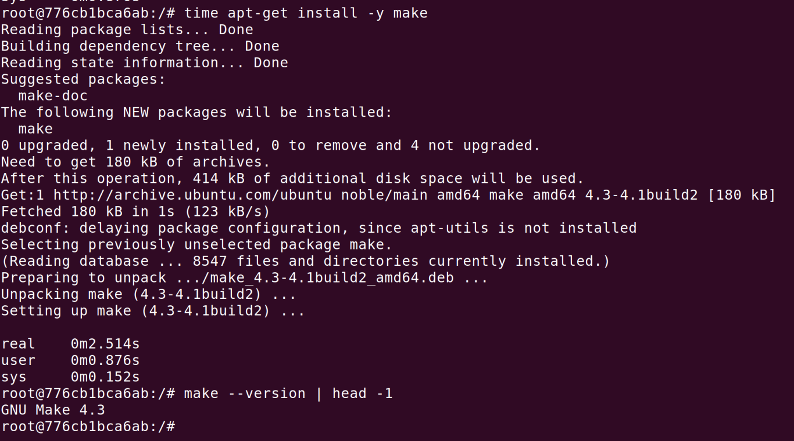
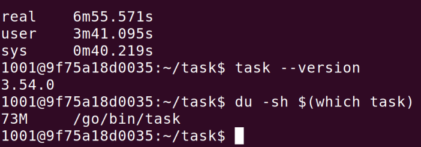
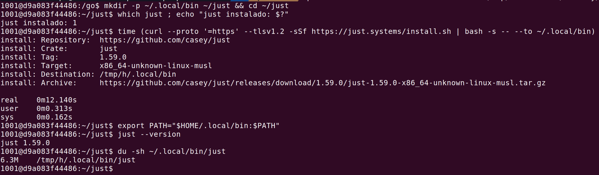
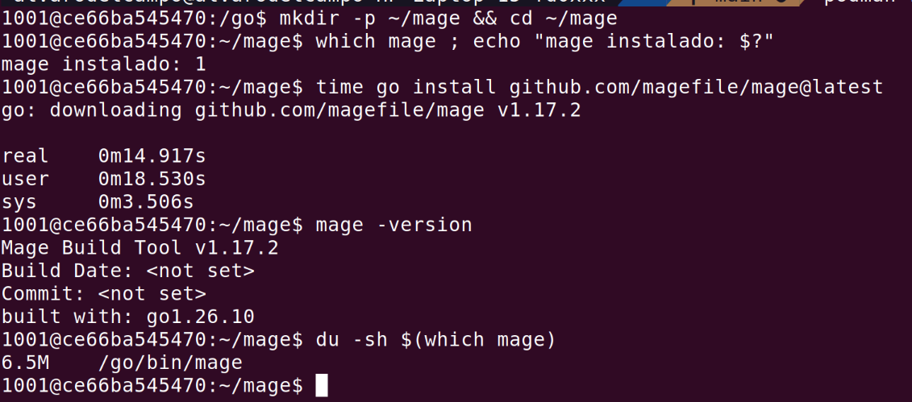

# Herramientas para trabajar con el proyecto

Todo lo que se elige aquí se usará también en el contenedor y en la integración continua. Para probar cada opción usamos un contenedor de podman con Ubuntu 24.04 y el usuario alumno, sin permisos de
administrador. De la instalación nos fijamos en el tiempo, porque se repetirá en cada construcción del contenedor y en cada ejecución de la integración continua. Parte de ese tiempo es de descarga y depende 
de la red, así que cuando una herramienta tarda porque tiene que compilarse lo indicamos, porque eso no depende de la red.

## Gestión de las dependencias (#26)

Go tiene un gestor de dependencias estándar, [Go modules](https://go.dev/ref/mod), que viene con el propio lenguje y usa el fichero `go.mod`. No hay alternativas que valorar, ya que las que aparecen al buscar o están abandonadas, como [dep](https://github.com/golang/dep) y [Glide](https://github.com/Masterminds/glide), o son sistemas de construcción para monorepos, no son gestores de dependencias, que también usan el `go.mod`, como Bazel. Por eso usamos Go modules.

## Gestor de tareas (#27)

Para trabajar con el código hacen falta tres tareas: instalar las dependencias, comprobar la sintaxis y pasar los tests. Ahora cada una es una orden distinta de `go` que hay que conocer.

### Criterios

- **Tiempo de instalación** La herramienta se instalará al preparar el entorno.
- **Tiempo de ejecución**  Las tareas se ejecutarán en cada cambio, así que cuanto menos tarden, mejor.
- **Puede generar un fichero a partir de otro, solo cuando este cambia.** No entra en este milestone, pero más adelante habrá que generar los datos a partir de los PDF de la UGR, y así no habría que cambiar
de herramienta más adelante.

### Opciones

- **[Make](https://www.gnu.org/software/make/):** gestor de tareas genérico, con un `Makefile`.
- **[Task](https://taskfile.dev/):** gestor de tareas escrito en Go, con un `Taskfile.yml`.
- **[Just](https://github.com/casey/just):** gestor de tareas escrito en Rust, con un `justfile`.
- **[Mage](https://magefile.org/):** las tareas se escriben en Go, en un `magefile.go`.

### Pruebas

El tiempo de ejecución se mide con `make check` y `make test` sobre el propio proyecto, con la caché de Go vacía. Como referencia, sin ningún gestor `gofmt -e .` tarda 0,007 s y `go test ./...` 3,65 s.

**Make.** Se instala con apt en 2,5 s. `check`tarda 0,03 s y `test` 3,65 s, así que no añade nada. Regenera un fichero solo cuando cambia el de origen.

**Task.** Instalarlo tardó casi 7 minutos, porque lo compila entero. `check` tarda 0,1 s, unos 75 ms más que sin gestor, porque antes lee el Taskfile.yml y `test` 3,54 s. Regenera solo cuando cambia, pero para saberlo crea una carpeta `.task` dentro del proyecto.

**Just.** Se instala en 12 s con su script, que descarga el programa ya compilado. `check` tarda 0,013 s y `test` 3,58 s, así que casi no añade nada. No sabe regenerar solo cuando cambia, repite la tarea cada vez.

**Mage.** Se instala con `go install` en 15 s. Con la caché vacía, el primer `check` tarda 3,57 s, porque antes compila el `magefile.go`. Puede regenerar solo cuando cambia, pero para eso Mage tiene que añadirse como dependencia del proyecto.

### Decisión

Elegimos **Make**.

Es la única opción que cumple los cinco criterios. Usar solo `go` no da un fichero de tareas: son tres órdenes sueltas, una de ellas de otro programa (`gofmt`), y `go generate` regenera los ficheros siempre. 
Task funciona, pero instalarlo tardó casi 7 minutos porque lo compila entero, o, si se fija en el `go.mod`, le añade 130 líneas y un `go.sum` de 252 a un proyecto sin dependencias; además, para saber qué 
regenerar crea una carpeta `.task` dentro del proyecto. Just es otra herramienta que instalar aparte y no puede generar ficheros solo cuando cambian. Mage ni siquiera funciona con el código en solo lectura,
y para generar ficheros tiene que añadirse como dependencia.

Make está en la imagen oficial de Go, así que en el contenedor y en la integración continua no hay que instalar nada, funciona con el código en solo lectura y es el único que genera un fichero a partir de 
otro solo cuando cambia sin escribir nada más en el proyecto. Su coste es que no viene en Ubuntu Desktop ni en un Ubuntu mínimo: en una máquina de desarrollo sin Make hay que instalarlo con apt, con permisos 
de administrador. Task, Just y Mage tampoco vienen en ninguna de esas máquinas, y además habría que instalarlos en el contenedor y en la integración continua.

El tiempo de ejecución no cambia la decisión: Make es, junto con Just, el que menos añade a las órdenes de Go, y Mage, que ya fallaba con el código en solo lectura, es además el más lento cuando la caché 
está vacía.

No usamos el gestor de dependencias (`go`) como gestor de tareas porque no tiene un fichero de tareas, pero Make no lo sustituye: cada tarea del `Makefile` es una orden de `go` o `gofmt`.