# Herramientas para trabajar con el proyecto

Todo lo que se elige aquí se usará también en el contenedor y en la integración continua. Para probar cada opción usamos un contenedor de podman con Ubuntu 24.04 y el usuario alumno, sin permisos de
administrador. De la instalación nos fijamos en el tiempo, porque se repetirá en cada construcción del contenedor y en cada ejecución de la integración continua. Parte de ese tiempo es de descarga y depende 
de la red, así que cuando una herramienta tarda porque tiene que compilarse lo indicamos, porque eso no depende de la red.

## Instalación y versión de Go (#14)

Para trabajar en el proyecto hay que instalar Go y poder cambiar de versión desde la línea de órdenes. Ahora mismo el repositorio no dice qué versión usar ni cómo instalarla, así que cada persona podría
compilar con una distinta.

### Criterios

- **Sin permisos de administrador.** Se tiene que poder instalar en el espacio del usuario, como acordamos en el #14.
- **Fija la versión en el repositorio.** Así todos, el contenedor y la integración continua usan la misma versión.
- **Cambia de versión con una orden.** Para probar el código con otra versión sin reinstalar nada a mano.
- **Tiempo de instalación.** Se instalará cada vez que se construya el contenedor y en cada ejecución de la integración continua, así que cuanto menos tarde, mejor.

### Opciones

- **apt:** el paquete de Go de Ubuntu.
- **Binario oficial:** descargar Go de [go.dev/dl](https://go.dev/dl/) y usar el mecanismo de Go para cambiar de versión desde el `go.mod` ([toolchain](https://go.dev/doc/toolchain)).
- **Versiones paralelas oficiales:** [`golang.org/dl`](https://go.dev/doc/manage-install), que instala otras versiones junto a la que ya hay.
- **[mise](https://mise.jdx.dev/lang/go.html):** gestor de versiones para varios lenguajes.
- **[goenv](https://github.com/go-nv/goenv):** gestor de versiones solo para Go.

Hay más opciones, pero hacen lo mismo que alguna de estas: asdf es parecido a mise; gvm, g y gobrew son parecidos a goenv; snap es otro paquete del sistema, como apt. Nix y los contenedores de desarrollo 
preparan un entorno completo, que es más de lo que pide el #14. Por eso probamos una de cada tipo.

### Pruebas

**apt.** Sin permisos de administrador no se puede instalar Go con apt, como se ve en la captura. Por eso esta opción queda descartada.

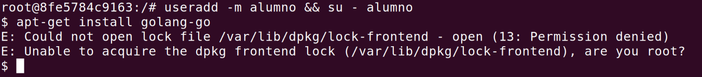

**Binario oficial.** Sí se puede descargar e instalar sin permisos de administrador, en `~/.local/go`. La instalación es descargar el archivo y descomprimirlo: la descarga tardó 1 min 30 s, que depende de la 
red, y descomprimirlo 1,8 s. Hay un paso manual: añadir `~/.local/go/bin` al `PATH` en el `~/.bashrc`.

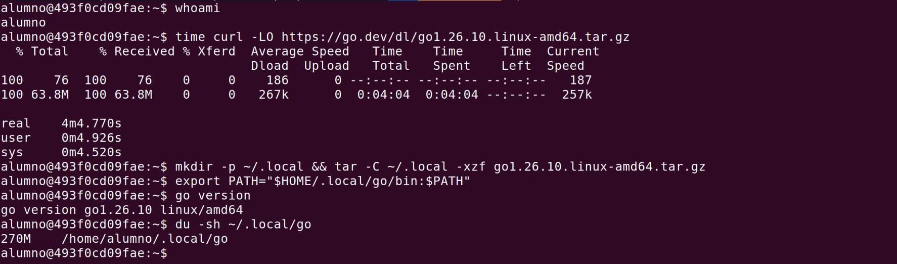

La versión queda fijada en el propio `go.mod` (`go mod init` escribe `go 1.26.10`) y no hace falta ningún otro fichero. Para cambiar de versión basta una orden, `go mod edit -go=1.27.3`: la siguiente vez que
se ejecuta `go`, descarga la 1.27.3 y la usa.

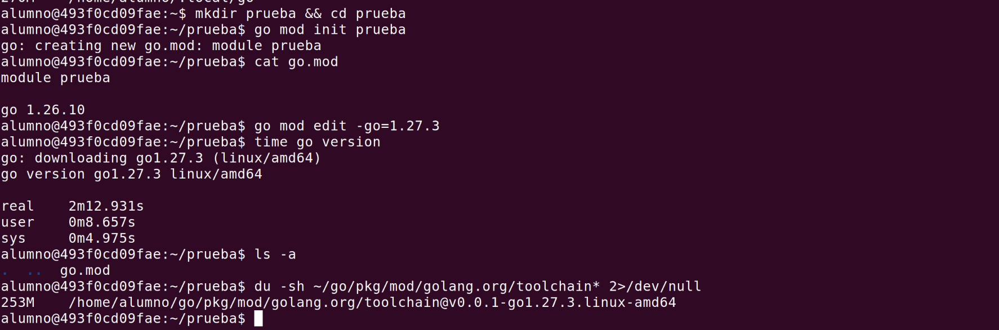

**Versiones paralelas oficiales (`golang.org/dl`).** Para usarlas hace falta tener Go instalado antes, así que no sirven para instalar Go, solo para añadir otras versiones. Se instalan sin permisos de
administrador. Instalar la orden `go1.27.3` tardó 9 s.

Las dos versiones conviven: `go` sigue siendo la 1.26.10 y `go1.27.3` es la 1.27.3. Para cambiar de versión hay que usar otra orden. El problema es que no fija la versión en el repositorio: en el directorio 
solo está el `go.mod`, y ese `go 1.26.10` lo escribió el `go` normal. Nada en el repositorio dice qué orden tiene que usar cada persona. Sirve para probar otra versión, pero no para fijar la del proyecto.

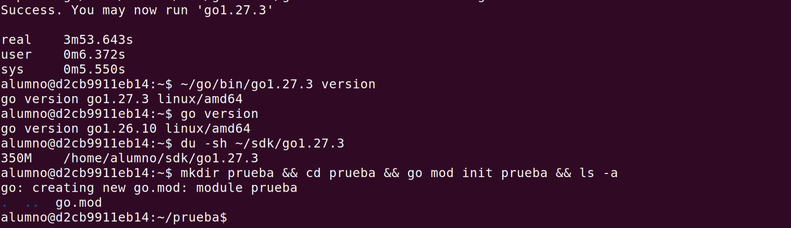

**mise.** Es un gestor de versiones para varios lenguajes, no solo para Go. Se instala sin permisos de administrador: el script deja el programa en `~/.local/bin` y tardó 13 s.

Permite fijar la versión de Go, pero en su propio fichero, `mise.toml`, así que la versión quedaría escrita en dos sitios: ahí y en el `go.mod`. Cambiar de versión es una orden (`mise use go@<versión>`),
pero para usarla hay que lanzar las órdenes con `mise exec` o activar mise en la terminal.

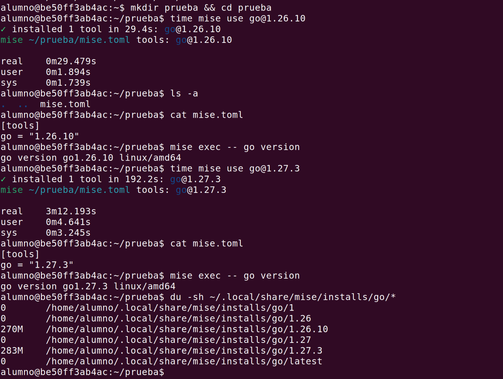

Por defecto no lee la versión del `go.mod`: sin `mise.toml`, `mise current go` avisa de que no hay ninguna versión fijada. Se puede activar con `mise settings add idiomatic_version_file_enable_tools go`, 
pero esa opción se guarda en `~/.config/mise/config.toml`, en la configuración de cada usuario y no en el repositorio. Así que o se añade un `mise.toml` al repositorio, o cada persona, el contenedor y la CI 
tienen que configurarlo por su cuenta.

**goenv.** Es un gestor de versiones solo para Go. Se instala sin permisos de administrador con un `git clone` en `~/.goenv`, que tardó 3,7 s. A cambio, necesita `git` y tres líneas en el 
`~/.bashrc`: la variable `GOENV_ROOT`, el `PATH` y `eval "$(goenv init -)"`.

Permite fijar la versión, pero en su propio fichero, `.go-version`, así que, igual que con mise, la versión quedaría en dos sitios. Cambiar de versión es una orden (`goenv local <versión>`) y después `go`
usa esa versión directamente, sin `exec`. Antes hay que instalarla con `goenv install`.

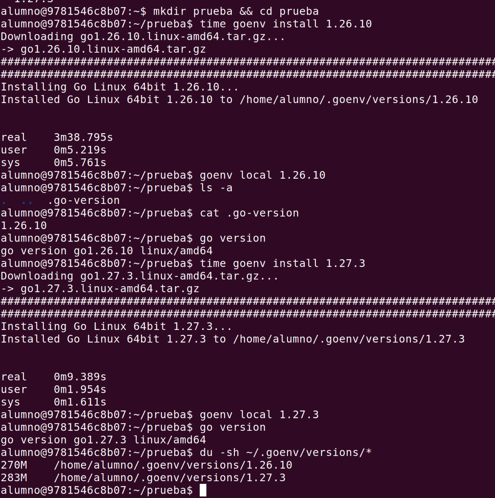

Por defecto no lee la versión del `go.mod`: sin `.go-version`, `goenv version` devuelve la del sistema. Con la variable `GOENV_GOMOD_VERSION_ENABLE=1` sí la lee, pero es una variable de cada usuario, no del
repositorio. Igual que con mise, o se añade un `.go-version` al repositorio, o cada persona, el contenedor y la CI tienen que configurarla.

### Decisión

Elegimos el **binario oficial**, y la versión se fija en el `go.mod` con el mecanismo propio de Go.

Es la única opción que cumple los cuatro criterios sin añadir nada al proyecto. apt necesita permisos de administrador. `golang.org/dl` necesita tener Go instalado antes y no deja la versión fijada en el
repositorio. mise y goenv sí cumplen los criterios, pero cada uno escribe la versión en su propio fichero (`mise.toml` o `.go-version`), además de en el `go.mod`. Para que lean el `go.mod`, cada persona, el
contenedor y la integración continua tendrían que configurarlos, y eso es justo lo que queremos evitar.

Esta opción también tiene su coste: hay que añadir `~/.local/go/bin` al `PATH` a mano. A cambio, no hace falta instalar ninguna herramienta aparte.

La versión quedará escrita en el `go.mod` cuando se cree, en el #26.

## Gestión de las dependencias (#26)

Ahora mismo el código no es un módulo de Go y no hay forma de declarar ni instalar dependencias. Todavía no tenemos ninguna, pero en este milestone pueden llegar (por ejemplo, para los tests).

### Criterios

- **Está mantenido.** Una herramienta abandonada habría que cambiarla más adelante.
- **No hace falta instalar nada más que Go.** Cada herramienta extra hay que instalarla en cada máquina, en el contenedor y en la integración continua.
- **No escribe en el código al compilar.** En el contenedor el código estará montado en solo lectura.
- **Tiempo de instalación.** Se instalará cada vez que se construya el contenedor y en cada ejecución de la integración continua, así que cuanto menos tarde, mejor.

### Herramienta considerada

Go tiene un estándar para gestionar las dependencias: [Go modules](https://go.dev/ref/mod), que viene con el propio lenguaje y usa el fichero `go.mod`. Como hay un estándar, es la herramienta que evaluamos 
con los criterios.

Al buscar otras opciones aparecen estas, que no se consideran:

- **[dep](https://github.com/golang/dep):** está archivado desde el 9 de septiembre de 2020.

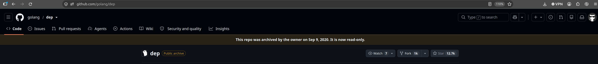

- **[Glide](https://github.com/Masterminds/glide):** su propio README dice que está prácticamente sin mantener y recomienda usar Go modules.

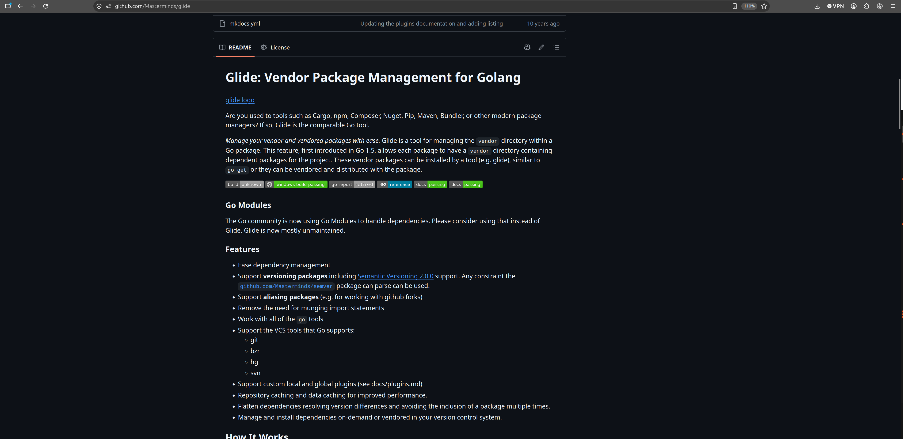

- **[Bazel](https://bazel.build/) y Buck2:** son sistemas de construcción para monorepos, no gestores de dependencias. Según la documentación de rules_go, Bazel ignora el `go.mod` y sus reglas se generan a 
partir de él con otra herramienta, Gazelle, así que sigue dependiendo de Go modules.

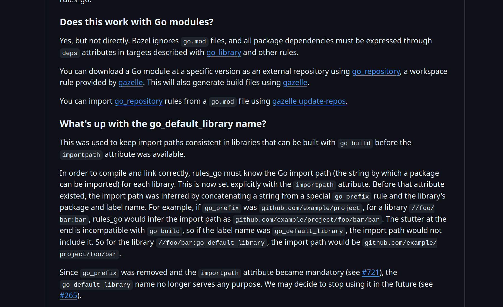

- **godep, govendor y el modo GOPATH:** son anteriores a Go modules y han quedado sustituidos por él.

### Pruebas

**Go modules.** No hace falta instalar nada más que Go. `go mod init` crea el `go.mod` con el nombre del módulo y la versión de Go, y no crea ningún otro fichero. Como todavía no hay dependencias, `go mod 
download` no descarga nada. Para comprobar lo del solo lectura, quitamos los permisos de escritura del directorio con `chmod -R a-w .`: `go build ./...` termina sin errores y el directorio queda igual que 
antes, sin ningún fichero nuevo. Al ser parte de Go, se mantiene junto con el lenguaje. Tanto go mod init como go mod download tardaron 0,01 s, y no hay que instalar nada.

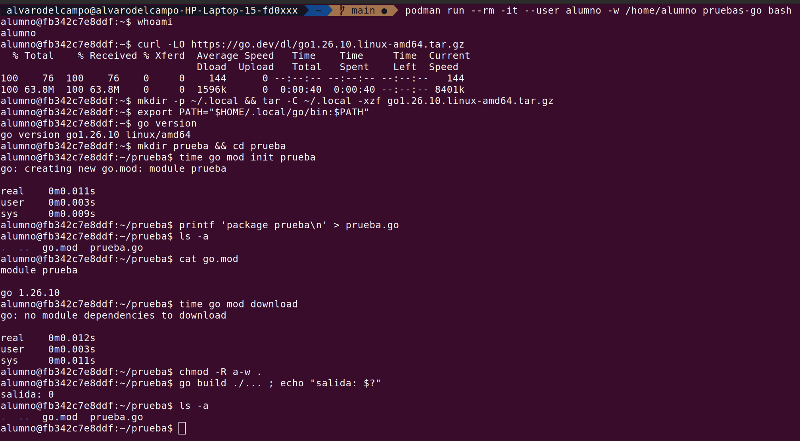

### Decisión

Elegimos **Go modules**, el estándar de Go. Cumple los cuatro criterios: forma parte de Go y se mantiene con él, no hay que instalar nada más, funciona con el código en solo lectura y tanto `go mod init` 
como `go mod download` tardaron 0,01 s.

Como todavía no hay dependencias, el `go.mod` solo tiene el nombre del módulo y la versión de Go. Ahí queda fijada la versión del proyecto, como se decidió en el #14.

## Gestor de tareas (#27)

Para trabajar con el código hacen falta tres tareas: instalar las dependencias, comprobar la sintaxis y pasar los tests. Ahora cada una es una orden distinta de `go` que hay que conocer.

### Criterios

- **Hace las tres tareas desde un fichero de tareas.** Así hay un único sitio con todas las órdenes del proyecto.
- **No hace falta instalar nada aparte en el contenedor ni en la integración continua.** Es donde se ejecutarán las tareas en cada cambio, y allí usaremos la imagen oficial de Go.
- **No escribe en el código.** En el contenedor el código estará montado en solo lectura.
- **Puede generar un fichero a partir de otro, solo cuando este cambia.** No entra en este milestone, pero más adelante habrá que generar los datos a partir de los PDF de la UGR, y así no habría que cambiar
de herramienta.
- **Tiempo de instalación y de ejecución.** La herramienta se instalará cada vez que se construya el contenedor y las tareas se ejecutarán en cada ejecución de la integración continua, así que cuanto menos 
tarden, mejor.

### Opciones

- **Solo `go`:** usar directamente las órdenes de Go, sin fichero de tareas.
- **[Make](https://www.gnu.org/software/make/):** gestor de tareas genérico, con un `Makefile`.
- **[Task](https://taskfile.dev/):** gestor de tareas escrito en Go, con un `Taskfile.yml`.
- **[Just](https://github.com/casey/just):** gestor de tareas escrito en Rust, con un `justfile`.
- **[Mage](https://magefile.org/):** las tareas se escriben en Go, en un `magefile.go`.

Hay más opciones, pero se parecen a alguna de estas: goyek también define las tareas en Go, como Mage; un script de shell es como usar `go` directamente pero en un fichero; y Earthly o Bazel son sistemas de 
construcción completos, más de lo que hace falta aquí. Por eso probamos una de cada tipo.

### Pruebas

**Orden para comprobar la sintaxis.** Antes de comparar los gestores de tareas, hay que elegir qué orden ejecuta la tarea `check`, porque solo tiene que comprobar la sintaxis. Lo probamos con tres ficheros: 
uno válido pero mal formateado, uno con un error de sintaxis y uno con un error de tipos (una variable que no existe), que es un error de compilación pero no de sintaxis. `gofmt -e` solo falla con el error 
de sintaxis, e indica la línea y la columna.

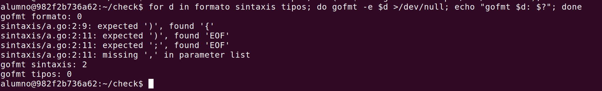

`go build` y `go vet` también fallan con el error de tipos, así que comprueban más que la sintaxis: `go build` compila el código y `go vet` además lo analiza. Ninguna de las tres órdenes crea ficheros en el 
directorio. Por eso la tarea `check` usará `gofmt -e`.

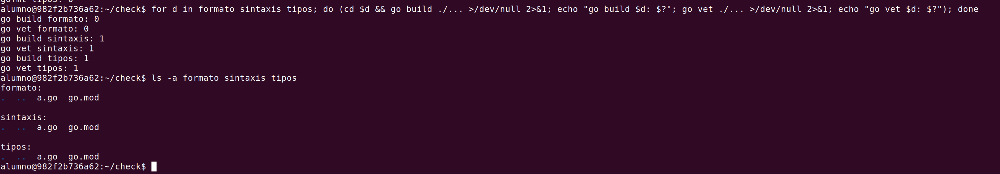

**Solo `go`.** No hace falta instalar nada más que Go, y las tres tareas funcionan con el código en solo lectura sin crear ningún fichero: `go mod download` para las dependencias, `gofmt -e .` para la 
sintaxis y `go test ./...` para los tests. El problema es que son tres órdenes sueltas que cada persona tiene que conocer, y `gofmt` ni siquiera es una orden de `go`, sino otro programa. No hay ningún 
fichero de tareas que las reúna.

Para generar ficheros, Go tiene `go generate`, pero no comprueba si el fichero de origen ha cambiado: lo ejecutamos dos veces seguidas sin tocar `entrada.txt` y las dos veces vuelve a generar `salida.txt`.

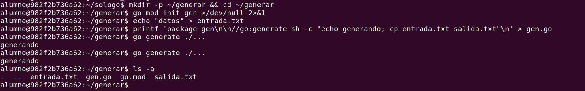

**Make.** No hace falta instalarlo donde se van a ejecutar las tareas: viene en la imagen oficial de Go (GNU Make 4.4.1), que es la que usaríamos en el contenedor, y en la máquina Ubuntu 24.04 de la 
integración continua de GitHub, según su [lista oficial de software](https://github.com/actions/runner-images/blob/main/images/ubuntu/Ubuntu2404-Readme.md). En cambio, no viene ni en un Ubuntu mínimo ni en
Ubuntu Desktop, según la [lista de paquetes de Ubuntu 24.04 Desktop](https://releases.ubuntu.com/24.04/ubuntu-24.04.5.1-desktop-amd64.manifest). En esas máquinas hay que instalarlo con apt, que necesita 
permisos de administrador.

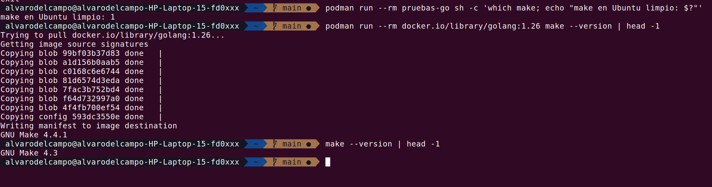

Las tres tareas quedan en un `Makefile` (`make installdeps`, `make check` y `make test`) y funcionan con el código en solo lectura, sin crear ningún fichero.

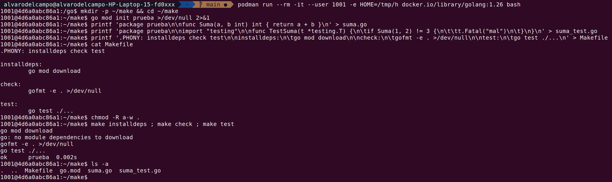

Además, puede generar un fichero a partir de otro solo cuando hace falta: la segunda vez que se ejecuta, dice que `salida.txt` ya está al día y no hace nada, y en cuanto cambia `entrada.txt` lo vuelve a 
generar.

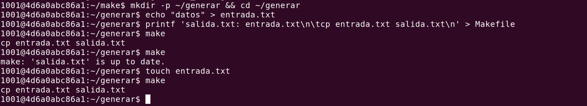

**Task.** No viene instalado. Se puede instalar con `go install`, sin permisos de administrador, pero tardó casi 7 minutos en compilarse. También se puede dejar fijado en el `go.mod` del proyecto con 
`go get -tool`, pero entonces mete todas sus dependencias: el `go.mod` pasa de 3 líneas a 130 y aparece un `go.sum` de 252 líneas, cuando el proyecto no tiene ninguna dependencia.

Las tres tareas quedan en un `Taskfile.yml` y funcionan con el código en solo lectura.

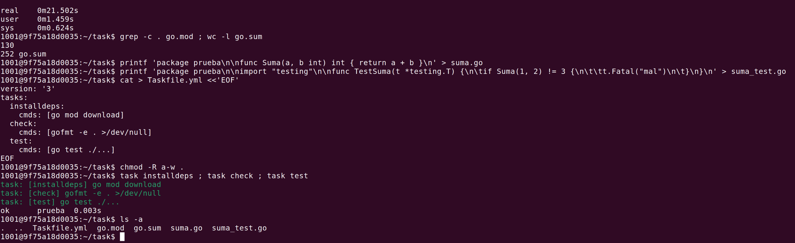

También puede generar un fichero solo cuando cambia el de origen: la segunda vez dice que la tarea está al día, y al cambiar `entrada.txt` la vuelve a ejecutar. Pero para saberlo guarda sus comprobaciones en 
una carpeta `.task` dentro del proyecto, que habría que añadir al `.gitignore` y que no podría escribir con el código en solo lectura.

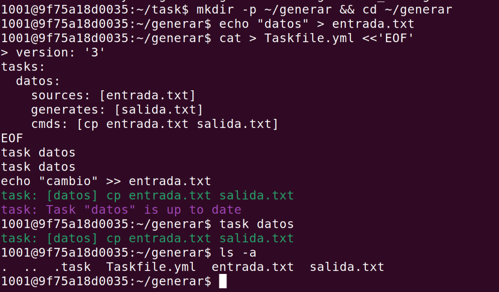

**Just.** No viene instalado y, como está escrito en Rust, no se puede instalar con Go ni fijar en el `go.mod`. Su script oficial descarga el programa ya compilado sin permisos de administrador: tardó 12 s.
Aun así, es una herramienta más que habría que instalar en cada máquina, en el contenedor y en la integración continua.

Las tres tareas quedan en un `justfile` y funcionan con el código en solo lectura, sin crear ningún fichero.

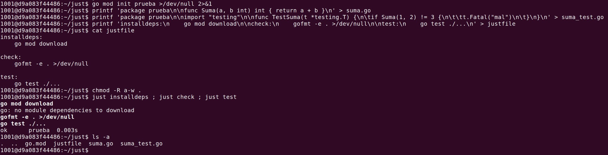

No puede generar un fichero solo cuando cambia el de origen: al ejecutar la misma tarea dos veces seguidas sin cambiar `entrada.txt`, vuelve a copiarlo las dos veces.

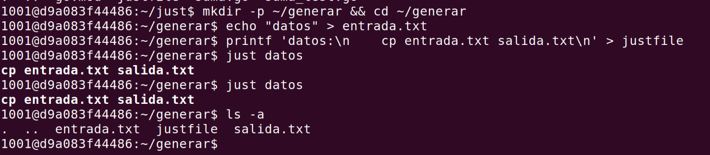

**Mage.** No viene instalado. Se instala con `go install`, sin permisos de administrador: tardó 15 s.

Las tareas se escriben en Go, en un `magefile.go`, que para las mismas tres órdenes necesitó 18 líneas. Pero con el código en solo lectura no funciona: las tres tareas fallan porque, para ejecutarlas, Mage 
intenta escribir un fichero (`mage_output_file.go`) dentro del proyecto.

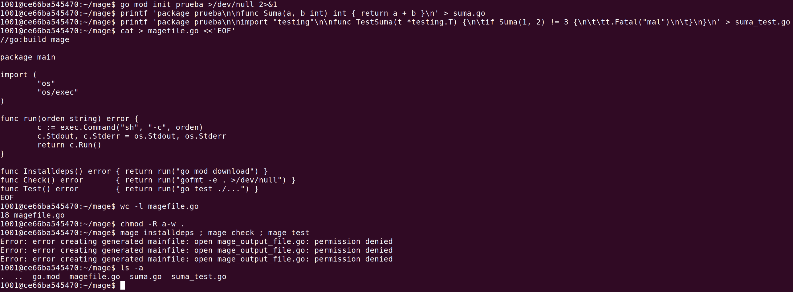

Puede generar un fichero solo cuando cambia el de origen, con su librería `target`: la segunda vez dice que está al día y, al cambiar `entrada.txt`, lo vuelve a generar. Pero para usar esa librería Mage 
tiene que añadirse como dependencia del proyecto, en el `go.mod` y con un `go.sum`.

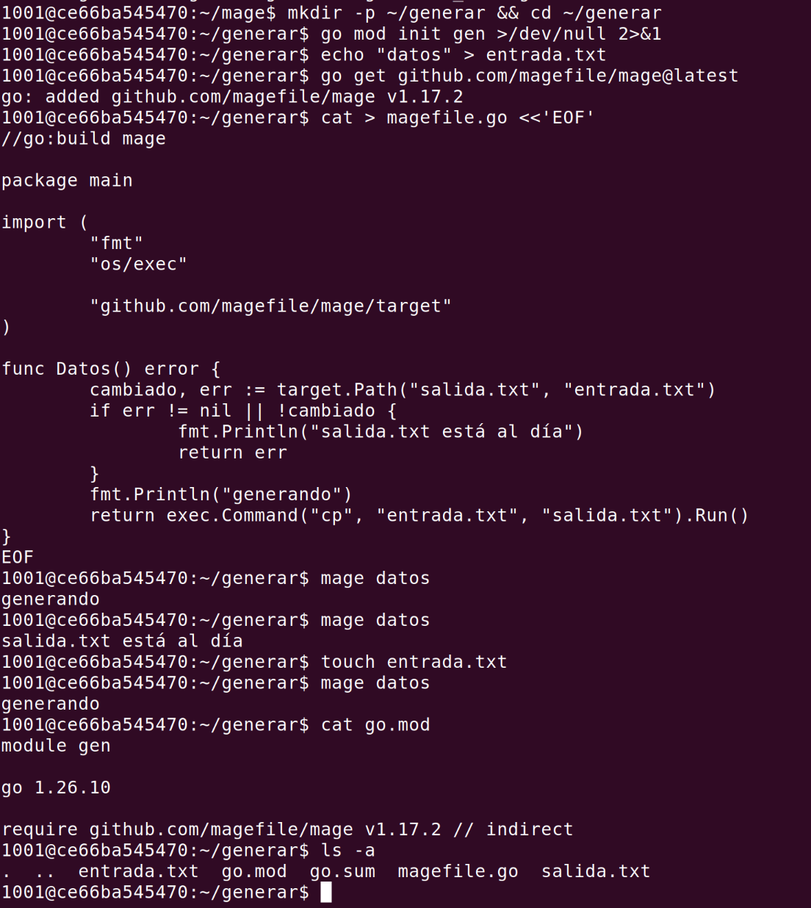

**Tiempo de ejecución.** Para medir cuánto añade cada gestor, ejecutamos `check` y `test` dos veces sobre el propio proyecto, en un contenedor nuevo para cada uno: la primera vez con la caché de Go vacía, 
como en la integración continua, y la segunda con la caché ya creada. Sin ningún gestor, `gofmt -e .` tarda 0,007 s, y `go test ./...` tarda 3,65 s la primera vez (casi todo es Go compilando lo necesario 
para los tests) y 0,09 s la segunda.

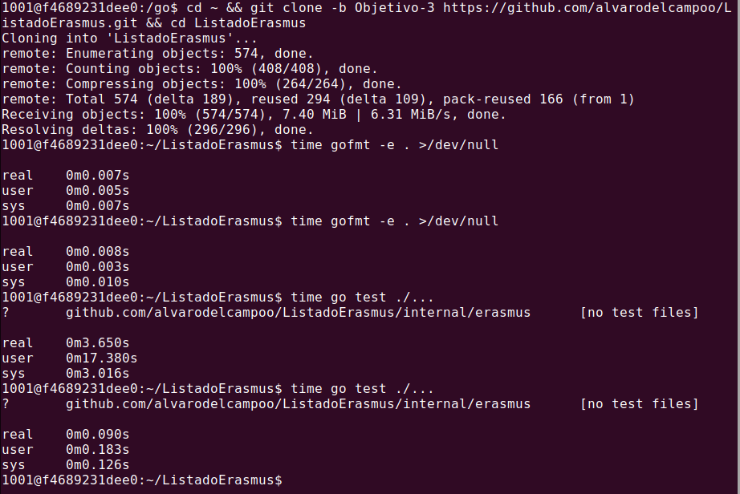

Make y Just casi no añaden nada: la primera vez, `check` tarda 0,03 s con Make y 0,013 s con Just, y `test` 3,65 s y 3,58 s.

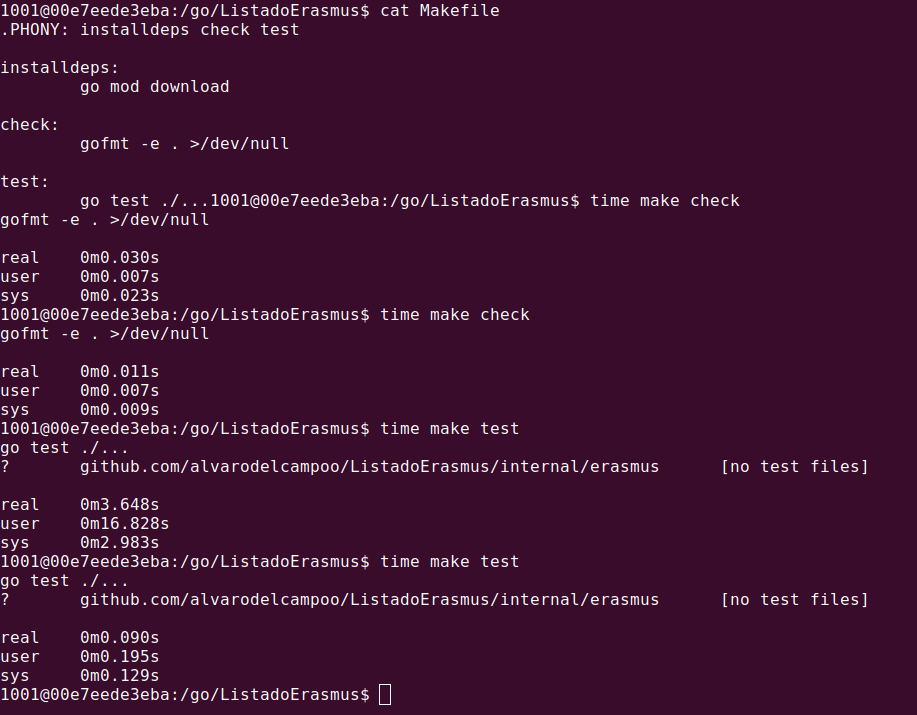
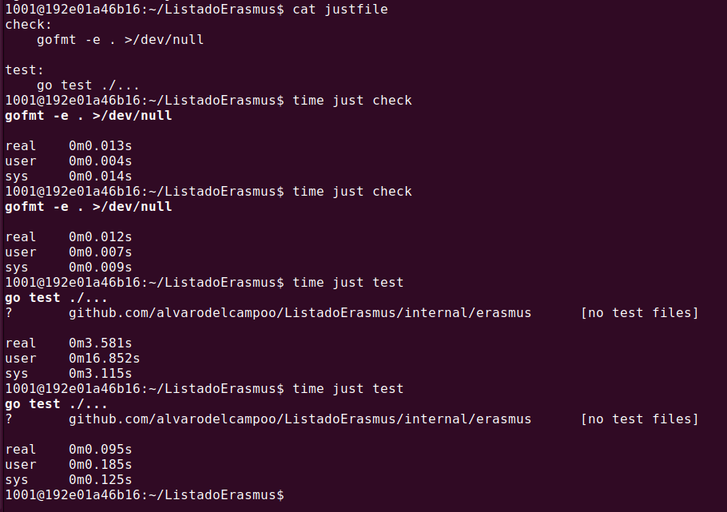

Task añade unos 75 ms a cada orden, porque antes de ejecutar nada lee el `Taskfile.yml`: `check` tarda 0,1 s. En `test` esa diferencia se pierde dentro de lo que tarda Go (3,54 s).

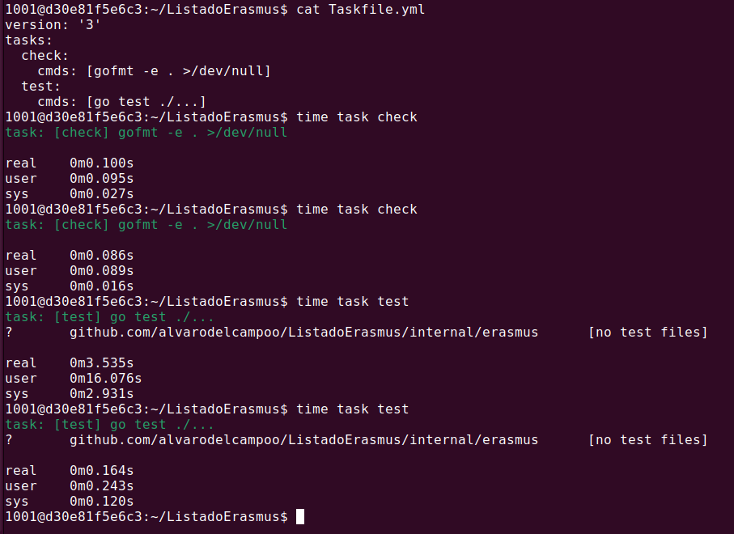

Mage es el único con una diferencia clara: con la caché vacía, el primer `mage check` tarda 3,57 s, porque antes de nada compila el `magefile.go`. Sumando las dos tareas en frío, como en la integración 
continua, Mage tarda 4,7 s y Make 3,7 s.

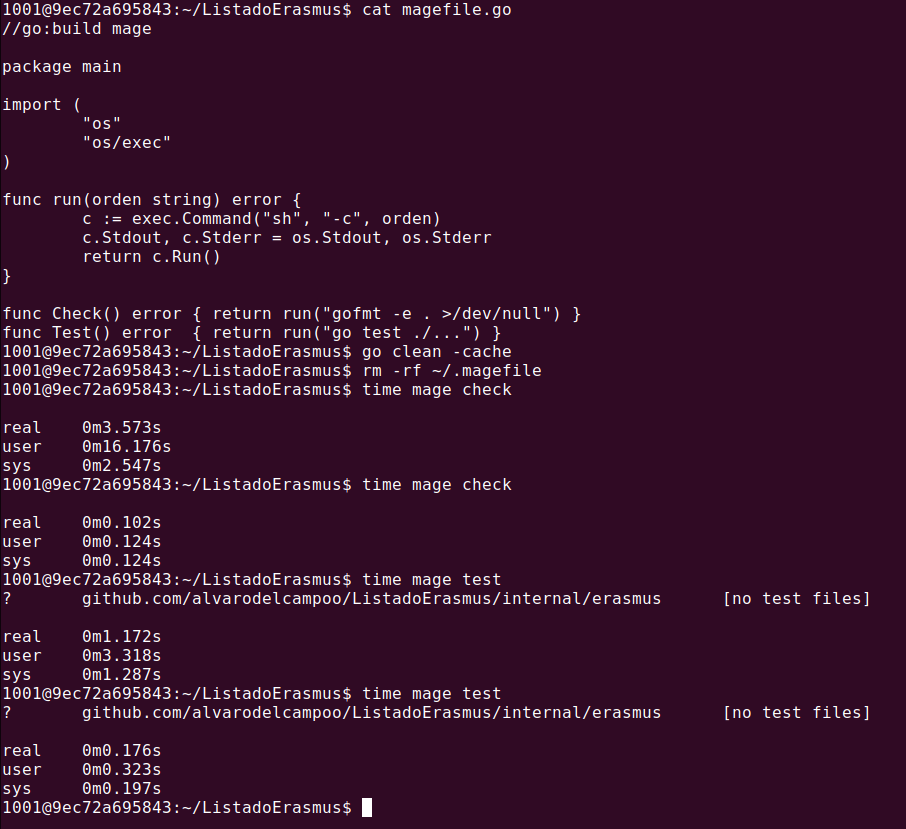

### Decisión

Elegimos **Make**.

Es la única opción que cumple los cinco criterios. Usar solo `go` no da un fichero de tareas: son tres órdenes sueltas, una de ellas de otro programa (`gofmt`), y `go generate` regenera los ficheros siempre. 
Task funciona, pero instalarlo tardó casi 7 minutos porque lo compila entero, o, si se fija en el `go.mod`, le añade 130 líneas y un `go.sum` de 252 a un proyecto sin dependencias; además, para saber qué 
regenerar crea una carpeta `.task` dentro del proyecto. Just es otra herramienta que instalar aparte y no puede generar ficheros solo cuando cambian. Mage ni siquiera funciona con el código en solo lectura,
y para generar ficheros tiene que añadirse como dependencia.

Make está en la imagen oficial de Go, así que en el contenedor y en la integración continua no hay que instalar nada, funciona con el código en solo lectura y es el único que genera un fichero a partir de 
otro solo cuando cambia sin escribir nada más en el proyecto. Su coste es que no viene en Ubuntu Desktop ni en un Ubuntu mínimo: en una máquina de desarrollo sin Make hay que instalarlo con apt, con permisos 
de administrador. Task, Just y Mage tampoco vienen en ninguna de esas máquinas, y además habría que instalarlos en el contenedor y en la integración continua.

El tiempo de ejecución no cambia la decisión: Make es, junto con Just, el que menos añade a las órdenes de Go, y Mage, que ya fallaba con el código en solo lectura, es además el más lento cuando la caché 
está vacía.

No usamos el gestor de dependencias (`go`) como gestor de tareas porque no tiene un fichero de tareas, pero Make no lo sustituye: cada tarea del `Makefile` es una orden de `go` o `gofmt`.