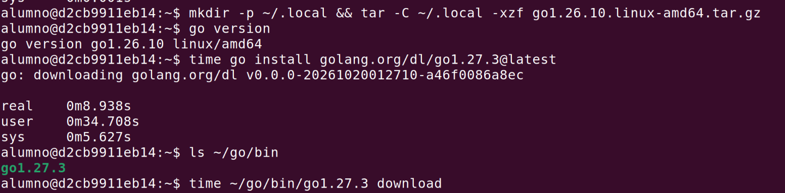
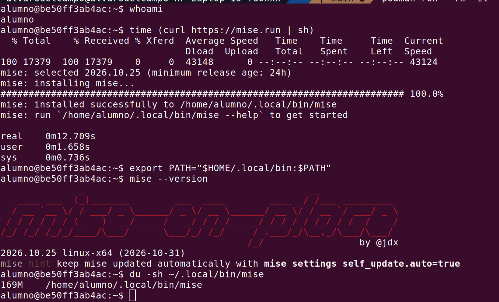
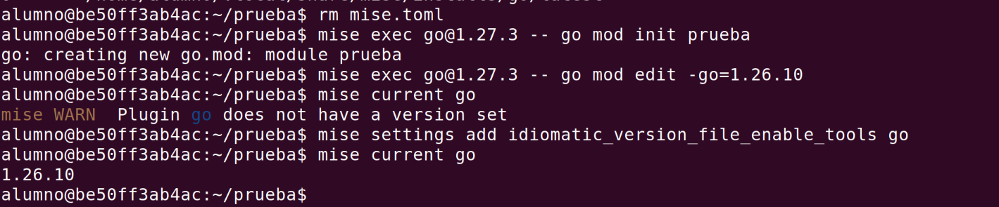
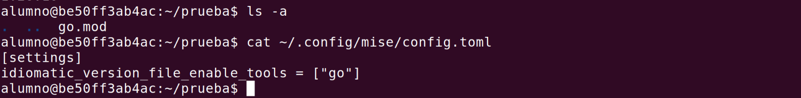
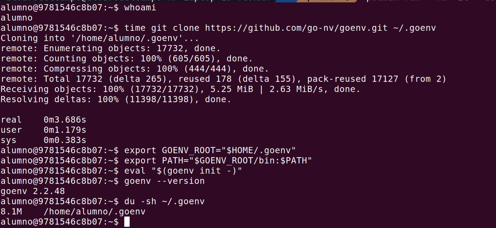
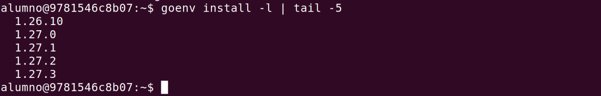
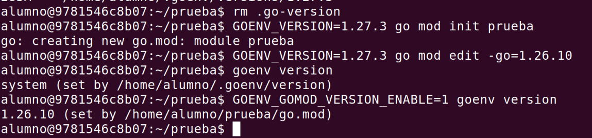
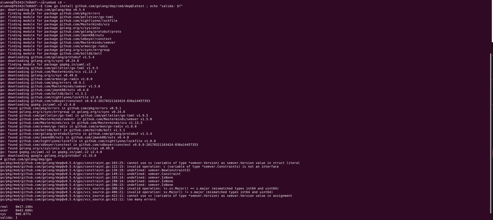
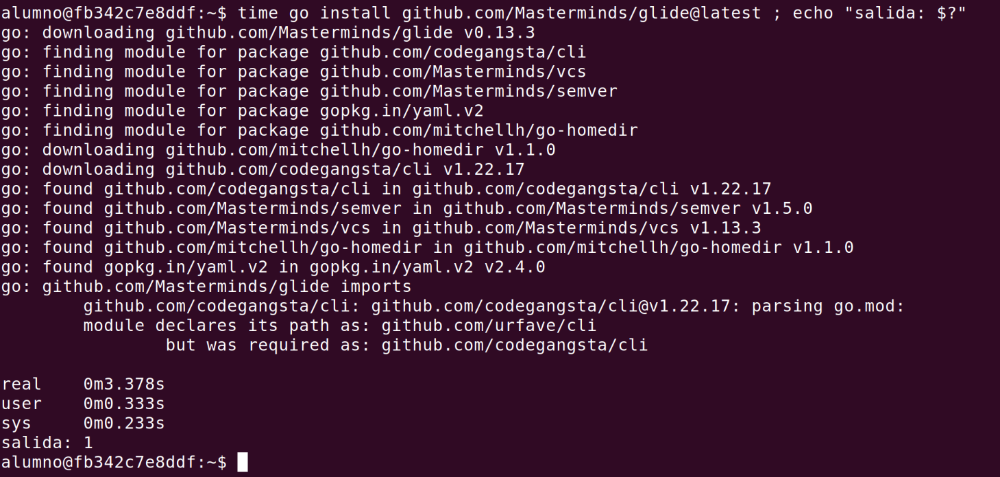
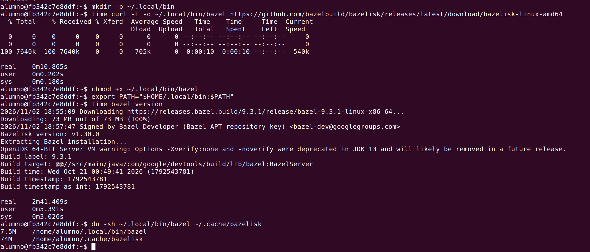

# Herramientas para trabajar con el proyecto

## Instalación y versión de Go (#14)

Para trabajar en el proyecto hay que instalar Go y poder cambiar de versión desde la línea de órdenes. Ahora mismo el repositorio no dice qué versión usar ni cómo instalarla, así que cada persona podría compilar con una distinta.

### Criterios

- **Sin permisos de administrador.** Se tiene que poder instalar en el espacio del usuario, como acordamos en el #14. Lo mismo hará falta en el contenedor y en la integración continua.
- **Fija la versión en el repositorio.** Así todos, el contenedor y la integración continua usan la misma versión.
- **Cambia de versión con una orden.** Para probar el código con otra versión sin reinstalar nada a mano.

### Opciones

- **apt:** el paquete de Go de Ubuntu.
- **Binario oficial:** descargar Go de [go.dev/dl](https://go.dev/dl/) y usar el mecanismo de Go para cambiar de versión desde el `go.mod` ([toolchain](https://go.dev/doc/toolchain)).
- **Versiones paralelas oficiales:** [`golang.org/dl`](https://go.dev/doc/manage-install), que instala otras versiones junto a la que ya hay.
- **[mise](https://mise.jdx.dev/lang/go.html):** gestor de versiones para varios lenguajes.
- **[goenv](https://github.com/go-nv/goenv):** gestor de versiones solo para Go.

Hay más opciones, pero hacen lo mismo que alguna de estas: asdf es parecido a mise; gvm, g y gobrew son parecidos a goenv; snap es otro paquete del sistema, como apt. Nix y los contenedores de desarrollo preparan un entorno completo, que es más de lo que pide el #14. Por eso probamos una de cada tipo.

### Pruebas

Para probar cada opción usamos un entorno limpio con un usuario sin permisos de administrador. Para ello usamos un contenedor de podman con Ubuntu 24.04 y el usuario `alumno`.

**apt.** Sin permisos de administrador no se puede instalar Go con apt, como se ve en la captura. Por eso esta opción queda descartada.

**Binario oficial.** Sí se puede descargar e instalar sin permisos de administrador, en `~/.local/go`. La descarga es de 63,8 MB y, una vez instalado, ocupa 270 MB. Hay un paso manual: añadir `~/.local/go/bin` al `PATH` en el `~/.bashrc`.

La versión queda fijada en el propio `go.mod` (`go mod init` escribe `go 1.26.10`) y no hace falta ningún otro fichero. Para cambiar de versión basta una orden, `go mod edit -go=1.27.3`: la siguiente vez que se ejecuta `go`, descarga la 1.27.3 y la usa. Cada versión que se descarga así ocupa 253 MB más.

**Versiones paralelas oficiales (`golang.org/dl`).** Para usarlas hace falta tener Go instalado antes, así que no sirven para instalar Go, solo para añadir otras versiones. Se instalan sin permisos de administrador. Instalar la orden `go1.27.3` tardó 9 s y la versión descargada ocupa 350 MB, más que los 253 MB de la misma versión con el binario oficial.

Las dos versiones conviven: `go` sigue siendo la 1.26.10 y `go1.27.3` es la 1.27.3. Para cambiar de versión hay que usar otra orden. El problema es que no fija la versión en el repositorio: en el directorio solo está el `go.mod`, y ese `go 1.26.10` lo escribió el `go` normal. Nada en el repositorio dice qué orden tiene que usar cada persona. Sirve para probar otra versión, pero no para fijar la del proyecto.

**mise.** Es un gestor de versiones para varios lenguajes, no solo para Go. Se instala sin permisos de administrador: el script deja el programa en `~/.local/bin` y tardó 13 s. El programa ocupa 169 MB antes de instalar ninguna versión de Go.

Permite fijar la versión de Go, pero en su propio fichero, `mise.toml`, así que la versión quedaría escrita en dos sitios: ahí y en el `go.mod`. Cambiar de versión es una orden (`mise use go@<versión>`), pero para usarla hay que lanzar las órdenes con `mise exec` o activar mise en la terminal. La 1.26.10 ocupa 270 MB y la 1.27.3, 283 MB.

Por defecto no lee la versión del `go.mod`: sin `mise.toml`, `mise current go` avisa de que no hay ninguna versión fijada. Se puede activar con `mise settings add idiomatic_version_file_enable_tools go`, pero esa opción se guarda en `~/.config/mise/config.toml`, en la configuración de cada usuario y no en el repositorio. Así que o se añade un `mise.toml` al repositorio, o cada persona, el contenedor y la CI tienen que configurarlo por su cuenta.

**goenv.** Es un gestor de versiones solo para Go. Se instala sin permisos de administrador con un `git clone` en `~/.goenv`, que tardó 3,7 s y ocupa 8,1 MB. A cambio, necesita `git` y tres líneas en el `~/.bashrc`: la variable `GOENV_ROOT`, el `PATH` y `eval "$(goenv init -)"`.

Su lista de versiones de Go está al día: incluye la 1.26.10 y la 1.27.3.

Permite fijar la versión, pero en su propio fichero, `.go-version`, así que, igual que con mise, la versión quedaría en dos sitios. Cambiar de versión es una orden (`goenv local <versión>`) y después `go` usa esa versión directamente, sin `exec`. Antes hay que instalarla con `goenv install`. La 1.26.10 ocupa 270 MB y la 1.27.3, 283 MB.

Por defecto no lee la versión del `go.mod`: sin `.go-version`, `goenv version` devuelve la del sistema. Con la variable `GOENV_GOMOD_VERSION_ENABLE=1` sí la lee, pero es una variable de cada usuario, no del repositorio. Igual que con mise, o se añade un `.go-version` al repositorio, o cada persona, el contenedor y la CI tienen que configurarla.

### Decisión

Elegimos el **binario oficial**, y la versión se fija en el `go.mod` con el mecanismo propio de Go.

Es la única opción que cumple los tres criterios sin añadir nada al proyecto. apt necesita permisos de administrador. `golang.org/dl` necesita tener Go instalado antes y no deja la versión fijada en el repositorio. mise y goenv sí cumplen los criterios, pero cada uno escribe la versión en su propio fichero (`mise.toml` o `.go-version`), además de en el `go.mod`. Para que lean el `go.mod`, cada persona, el contenedor y la integración continua tendrían que configurarlos, y eso es justo lo que queremos evitar.

Esta opción también tiene su coste: hay que añadir `~/.local/go/bin` al `PATH` a mano, y cada versión que Go descarga ocupa unos 253 MB más. Aun así es menos que con `golang.org/dl` (350 MB por versión), y no hace falta instalar ninguna herramienta aparte.

La versión quedará escrita en el `go.mod` cuando se cree, en el #26.

## Gestión de las dependencias (#26)

Ahora mismo el código no es un módulo de Go y no hay forma de declarar ni instalar dependencias. Todavía no tenemos ninguna, pero en este milestone pueden llegar (por ejemplo, para los tests), y lo que elijamos se va a instalar también en el contenedor y en la integración continua.

### Criterios

- **Está mantenido.** Una herramienta abandonada habría que cambiarla más adelante.
- **No hace falta instalar nada más que Go.** Cada herramienta extra hay que instalarla en cada máquina, en el contenedor y en la integración continua.
- **No escribe en el código al compilar.** En el contenedor el código estará montado en solo lectura.

### Opciones

- **[Go modules](https://go.dev/ref/mod):** el sistema de dependencias que trae Go, con el fichero `go.mod`.
- **[dep](https://github.com/golang/dep):** el gestor experimental que se usaba antes de Go modules.
- **[Glide](https://github.com/Masterminds/glide):** otro gestor externo anterior a Go modules.
- **[Bazel](https://bazel.build/) con [rules_go](https://github.com/bazel-contrib/rules_go):** un sistema de construcción que también gestiona dependencias.

Hay más opciones, pero se parecen a alguna de estas: Buck2 es un sistema de construcción como Bazel, y godep, govendor o el modo GOPATH son anteriores a Go modules, como dep y Glide. Por eso probamos una de cada tipo.

### Pruebas

Para probar cada opción usamos el mismo entorno que en el #14: un contenedor de podman con Ubuntu 24.04 y el usuario `alumno`, sin permisos de administrador.

**Go modules.** No hace falta instalar nada más que Go. `go mod init` crea el `go.mod` con el nombre del módulo y la versión de Go, y no crea ningún otro fichero. Como todavía no hay dependencias, `go mod download` no descarga nada. Para comprobar lo del solo lectura, quitamos los permisos de escritura del directorio con `chmod -R a-w .`: `go build ./...` termina sin errores y el directorio queda igual que antes, sin ningún fichero nuevo. Al ser parte de Go, se mantiene junto con el lenguaje.

**dep.** No está mantenido: su repositorio está archivado desde el 9 de septiembre de 2020 y ahora es de solo lectura.

Además, ya no se puede instalar. Con `go install` descarga sus dependencias, pero no compila porque las versiones actuales de esas dependencias han cambiado (por ejemplo, la de `semver`) y termina con error. Como el proyecto está archivado, nadie lo va a arreglar.

**Glide.** Su propio README dice que la comunidad de Go usa ahora Go modules, recomienda usarlo en su lugar y avisa de que Glide "is now mostly unmaintained" (está prácticamente sin mantener).

Tampoco se puede instalar: con `go install` falla porque una de sus dependencias, `codegangsta/cli`, ha cambiado de nombre a `urfave/cli`, y termina con error.

**Bazel.** Está mantenido: la versión que descarga, la 9.3.1, es de octubre de 2026. Se instala sin permisos de administrador a través de bazelisk, un programa de 7,5 MB que descarga y lanza Bazel. La primera vez que se ejecuta descarga Bazel, 73 MB más, y tardó casi 3 minutos. Además, arranca un servidor de Java para funcionar. Todo esto habría que instalarlo aparte de Go en cada máquina, en el contenedor y en la integración continua.

Tampoco sustituye a Go modules. Según la documentación de rules_go, Bazel ignora el `go.mod`, y las dependencias hay que declararlas otra vez en sus propios ficheros (`deps` en cada `go_library`) o generarlas a partir del `go.mod` con otra herramienta, Gazelle. Es decir, las dependencias quedarían en dos sitios.

### Decisión

Elegimos **Go modules**.

Es la única opción que cumple los tres criterios. dep y Glide están abandonados y ni siquiera se pueden instalar con las versiones actuales de sus dependencias. Bazel está mantenido, pero hay que instalarlo aparte de Go en cada máquina, en el contenedor y en la integración continua (unos 80 MB más), y además ignora el `go.mod`, así que las dependencias quedarían en dos sitios. Go modules viene con Go, no necesita instalar nada más y funciona con el código en solo lectura.

Como todavía no hay dependencias, el `go.mod` solo tiene el nombre del módulo y la versión de Go. Ahí queda fijada la versión del proyecto, como se decidió en el #14.

## Gestor de tareas (#27)

Para trabajar con el código hacen falta tres tareas: instalar las dependencias, comprobar la sintaxis y pasar los tests. Ahora cada una es una orden distinta de `go` que hay que conocer, y lo mismo pasará en el contenedor y en la integración continua.

### Criterios

- **Hace las tres tareas desde un fichero de tareas.** Así hay un único sitio con todas las órdenes del proyecto.
- **No hace falta instalar nada aparte.** Igual que con las dependencias: cada herramienta extra hay que instalarla en cada máquina, en el contenedor y en la integración continua.
- **No escribe en el código.** En el contenedor el código estará montado en solo lectura.
- **Puede generar un fichero a partir de otro, solo cuando este cambia.** No entra en este milestone, pero más adelante habrá que generar los datos a partir de los PDF de la UGR, y así no habría que cambiar de herramienta.

### Opciones

- **Solo `go`:** usar directamente las órdenes de Go, sin fichero de tareas.
- **[Make](https://www.gnu.org/software/make/):** gestor de tareas genérico, con un `Makefile`.
- **[Task](https://taskfile.dev/):** gestor de tareas escrito en Go, con un `Taskfile.yml`.
- **[Just](https://github.com/casey/just):** gestor de tareas escrito en Rust, con un `justfile`.
- **[Mage](https://magefile.org/):** las tareas se escriben en Go, en un `magefile.go`.

Hay más opciones, pero se parecen a alguna de estas: goyek también define las tareas en Go, como Mage; un script de shell es como usar `go` directamente pero en un fichero; y Earthly o Bazel son sistemas de construcción completos, más de lo que hace falta aquí. Por eso probamos una de cada tipo.

### Pruebas

Para probar cada opción usamos el mismo entorno que en el #14 y el #26: un contenedor de podman con Ubuntu 24.04 y el usuario `alumno`, sin permisos de administrador.

**Orden para comprobar la sintaxis.** Antes de comparar los gestores de tareas, hay que elegir qué orden ejecuta la tarea `check`, porque solo tiene que comprobar la sintaxis. Lo probamos con tres ficheros: uno válido pero mal formateado, uno con un error de sintaxis y uno con un error de tipos (una variable que no existe), que es un error de compilación pero no de sintaxis. `gofmt -e` solo falla con el error de sintaxis, e indica la línea y la columna.

`go build` y `go vet` también fallan con el error de tipos, así que comprueban más que la sintaxis: `go build` compila el código y `go vet` además lo analiza. Ninguna de las tres órdenes crea ficheros en el directorio. Por eso la tarea `check` usará `gofmt -e`.

