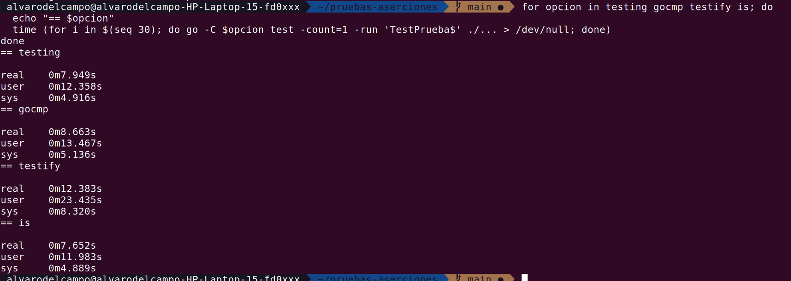

# Herramientas para los tests

## Criterios de búsqueda

Se han buscado herramientas para Go. Para cada nivel, biblioteca de aserciones, framework de tests y test runner, se ha buscado por separado, partiendo de lo que trae el propio lenguaje en su documentación oficial ([testing](https://pkg.go.dev/testing)) y añadiendo las alternativas más conocidas del apartado de testing de [Awesome Go](https://github.com/avelino/awesome-go#testing), una lista revisada de herramientas de Go.

## Biblioteca de aserciones

La biblioteca de aserciones es la que compara el resultado obtenido con el esperado y marca el test como fallido si no coinciden.

### Criterios

1. Lo fácil que es entender qué comprueba el test, siguiendo la S de [FIRST](https://medium.com/@tasdikrahman/f-i-r-s-t-principles-of-testing-1a497acda8d6): las líneas que ocupa la misma comprobación y las funciones propias de la herramienta que hay que conocer para leerla.
2. Cuando una comparación falla, tiene que decir cuál es el valor obtenido y cuál el esperado, para saber qué se ha leído mal.
3. Lo que añade al tiempo de cada ejecución de `make test`, que se paga cada vez que se lanzan los tests.

### Opciones

Cada opción se ha probado comparando el destino 2 leído de `datos/destinos.txt` con el esperado, cambiando un campo para ver qué muestra al fallar, y comprobando los errores de un listado con varios destinos mal formados. El tiempo se ha medido con `time`, lanzando 30 veces seguidas `go test -count=1` con esa misma comparación y dividiendo entre 30.

- **Sin biblioteca de aserciones, con el paquete estándar [testing](https://pkg.go.dev/testing):** se comprueba el resultado con un `if` y se marca el fallo con `t.Errorf`. El objeto se puede comparar con `reflect.DeepEqual` o comparando lo que imprimen los dos valores con `fmt.Sprint`. Con los errores juntados por `errors.Join`, `reflect.DeepEqual` compara también cómo están agrupados por dentro, mientras que `fmt.Sprint` muestra todos los que han fallado, y `errors.As` encuentra uno concreto. Al fallar muestra el mensaje que se le pasa a `t.Errorf`, con el valor obtenido y el esperado. Tarda 189 ms.
- **[go-cmp](https://github.com/google/go-cmp):** biblioteca para comparar valores, pensada como alternativa a `reflect.DeepEqual`. Al comparar el Destino con `cmp.Equal` da un panic por sus campos privados, salvo que se le pase `cmp.AllowUnexported` con cada tipo. Para buscar el error no tiene nada propio y hay que usar `errors.As`.
- **[testify](https://github.com/stretchr/testify):** la biblioteca de aserciones más usada en Go. Compara el Destino con `assert.Equal` y encuentra el error con `assert.ErrorAs`. Al fallar indica cuál es el valor esperado y cuál el obtenido, y marca el campo distinto. Tarda 288 ms.
- **[is](https://github.com/matryer/is):** biblioteca de aserciones mínima, con `is.Equal`, `is.NoErr` e `is.True`. Compara el Destino con `is.Equal`, pero para buscar el error hay que usar `errors.As` dentro de `is.True`. Al fallar muestra los dos valores separados por `!=`, sin decir cuál es el obtenido y cuál el esperado. Tarda 183 ms.

### Decisión

No usamos ninguna biblioteca de aserciones: los resultados se comprueban con un `if` y `t.Errorf` del paquete estándar `testing`, comparando lo que imprimen los dos valores con `fmt.Sprint`, que compara un objeto entero con sus campos privados. go-cmp no cumple el primer criterio sin configurarlo para cada tipo con campos privados e is no cumple el segundo, porque no dice cuál es el valor obtenido y cuál el esperado. testify cumple los dos, igual que `testing`, pero cada ejecución de los tests pasa de 189 ms a 288 ms, un 52 % más, sin que compruebe nada que no se pueda comprobar ya con `testing`.

## Framework de tests

Las comprobaciones con `if` y `t.Errorf` no agrupan nada por sí mismas, así que hace falta un framework que organice los tests. Todos los que se han mirado agrupan los casos en subtests con un nombre, para saber cuál ha fallado, y permiten crear los objetos que comparten varios tests. No hace falta planificar de antemano cuántos tests se ejecutan ni funciones antes o después de cada test, porque los tests deben ser independientes entre sí.

### Criterios

1. Que funcione con la forma elegida de comprobar los resultados, `if` y `t.Errorf` del paquete estándar `testing`.

### Opciones

- **Paquete estándar [testing](https://pkg.go.dev/testing):** cada test es una función `TestXxx(t *testing.T)`. Los casos se agrupan en subtests con `t.Run("nombre", ...)`, los objetos comunes se crean con funciones auxiliares o con `TestMain`, y si hay que limpiar algo está `t.Cleanup`.
- **[Ginkgo](https://github.com/onsi/ginkgo):** framework de estilo BDD (Behavior-Driven Development), en el que los tests se escriben como frases anidadas con bloques `Describe`, `Context` e `It`, y funciones como `BeforeEach` para preparar los objetos antes de cada caso. Está pensado para usarse con la biblioteca de aserciones Gomega y tiene su propia orden, `ginkgo`, para ejecutarlos.
- **[GoConvey](https://github.com/smartystreets/goconvey):** framework de estilo BDD (Behavior-Driven Development) con bloques `Convey` anidados y sus propias aserciones (`So`), con una interfaz web que relanza los tests al guardar.

### Decisión

Usamos el paquete estándar `testing`, que es el mismo paquete con el que comprobamos los resultados. Ginkgo y GoConvey no cumplen el criterio, porque traen su propia forma de comprobarlos: Ginkgo con Gomega y GoConvey con `So`.

## Test runner

El test runner es la orden que busca los tests del repositorio, los compila, los lanza e informa de cuáles pasan y cuáles fallan.

### Criterios

1. Tiene que ser él quien busque los tests desde la raíz del repositorio, los compile y los ejecute, y no una orden que llame a otra para alguna de esas tareas.
2. No puede escribir en el directorio de los fuentes, o tiene que poder configurarse para escribir en otro sitio, porque en el contenedor del siguiente objetivo ese directorio no tendrá permiso de escritura.

### Opciones

- **[go test](https://pkg.go.dev/cmd/go#hdr-Test_packages):** la orden que trae Go. Con `go test ./...` busca las funciones `TestXxx` de todos los paquetes, las compila y las ejecuta. Lo que compila lo guarda en la caché de Go, que está fuera del repositorio y se cambia de sitio con la variable `GOCACHE`.
- **[gotestsum](https://github.com/gotestyourself/gotestsum):** lanza `go test -json`, que es quien busca, compila y ejecuta los tests, y cambia el formato de la salida, con resúmenes y ficheros JUnit para la integración continua.
- **[ginkgo](https://github.com/onsi/ginkgo):** la orden del framework Ginkgo, pensada para sus suites. Busca los paquetes y ejecuta él mismo los tests, pero para compilarlos llama a `go test -c`, que deja el binario en el directorio del paquete salvo que se cambie con `-o`.

### Decisión

Usamos `go test ./...`, lanzado con `make test`. Busca, compila y ejecuta él mismo todos los tests desde la raíz, y solo escribe en la caché de Go, fuera de los fuentes y configurable con `GOCACHE`. gotestsum no cumple el primero, porque todo lo hace `go test -json`, y ginkgo tampoco, porque compila llamando a `go test -c`.

