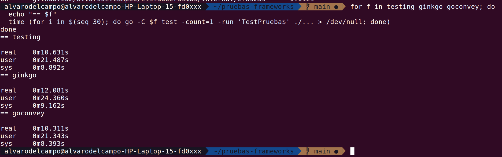
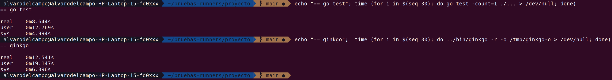

# Herramientas para los tests

## Criterios de búsqueda

Se han buscado herramientas para Go. Para cada nivel, biblioteca de aserciones, framework de tests y test runner, se ha buscado por separado, partiendo de lo que trae el propio lenguaje en su documentación oficial ([testing](https://pkg.go.dev/testing)) y añadiendo las alternativas más conocidas del apartado de testing de [Awesome Go](https://github.com/avelino/awesome-go#testing), una lista revisada de herramientas de Go.

En cada nivel, los criterios están ordenados por importancia: se aplica el primero y, solo entre las opciones que empaten en él, el siguiente. Lo fácil que es entender el test va antes que la velocidad porque cada vez que un test falla hay que leerlo para saber qué se ha roto.

## Biblioteca de aserciones

La biblioteca de aserciones es la que compara el resultado obtenido con el esperado y marca el test como fallido si no coinciden.

### Criterios

1. Lo fácil que es entender qué comprueba el test, siguiendo la S de [FIRST](https://medium.com/@tasdikrahman/f-i-r-s-t-principles-of-testing-1a497acda8d6): las líneas que ocupa la misma comprobación y las funciones propias de la herramienta que hay que conocer para leerla.
2. Lo que añade al tiempo de cada ejecución de `make test`, siguiendo la F de FIRST, que se paga cada vez que se lanzan los tests.

### Opciones

Cada opción se ha probado comparando el destino 2 leído de `datos/destinos.txt` con el esperado. Para el primer criterio se cuentan las líneas de comprobación y las funciones de la herramienta que hay que conocer para leerla. Para el segundo, el tiempo se ha medido con `time`, lanzando 30 veces seguidas `go test -count=1` con esa misma comparación y dividiendo entre 30.

- **Paquete estándar [testing](https://pkg.go.dev/testing):** se compara con `reflect.DeepEqual` y el fallo se marca con `t.Errorf`, escribiendo el mensaje a mano. La comprobación ocupa 3 líneas y usa 2 funciones, `reflect.DeepEqual` y `t.Errorf`. Tarda 265 ms.
- **[go-cmp](https://github.com/google/go-cmp):** biblioteca para comparar valores. Hay que pasarle `cmp.AllowUnexported` con cada tipo que tenga campos privados, y el fallo se marca con `t.Errorf`. La comprobación ocupa 3 líneas y usa 3 funciones, `cmp.Diff`, `cmp.AllowUnexported` y `t.Errorf`. Tarda 289 ms.
- **[testify](https://github.com/stretchr/testify):** la comprobación es `assert.Equal(t, esperado, obtenido)`, que ocupa 1 línea y usa 1 función. Tarda 413 ms.
- **[is](https://github.com/matryer/is):** la comprobación es `is.New(t).Equal(obtenido, esperado)`, que ocupa 1 línea y usa 2 funciones, `is.New` y `Equal`. Tarda 255 ms.

### Decisión

Usamos testify porque gana el primer criterio: la comprobación ocupa una línea y solo hay que conocer `assert.Equal`, mientras que is necesita dos funciones, y testing y go-cmp, tres líneas. Como no hay empate en el primero, el tiempo no llega a decidir, aunque testify sea la más lenta, con 413 ms frente a los 255 ms de is.

## Framework de tests

El framework de tests es el que organiza los tests: los agrupa con un nombre, para saber cuál ha fallado, y permite preparar lo que comparten varios de ellos.

### Criterios

1. Lo fácil que es entender el test, siguiendo la S de [FIRST](https://medium.com/@tasdikrahman/f-i-r-s-t-principles-of-testing-1a497acda8d6): las líneas que ocupa el mismo test y las funciones propias del framework que hay que conocer para leerlo.
2. Lo que añade al tiempo de cada ejecución de `make test`, siguiendo la F de FIRST, que se paga cada vez que se lanzan los tests.

### Opciones

Cada opción se ha probado con el mismo test, comprobar la nota ponderada de dos destinos reales, uno que pide inglés y otro que pide otro idioma. Para comparar solo el framework, las comprobaciones se hacen en los tres con la misma biblioteca de aserciones, testify. Para el primer criterio se cuentan las líneas del test y las funciones propias del framework que hay que conocer para leerlo. Para el segundo, el tiempo se ha medido con `time`, lanzando 30 veces seguidas `go test -count=1` con ese test y dividiendo entre 30.

- **Paquete estándar [testing](https://pkg.go.dev/testing):** cada caso se agrupa con `t.Run("nombre", ...)` dentro de una función `TestXxx`. El test ocupa 11 líneas y la función propia para agrupar es `t.Run`. Tarda 354 ms.
- **[Ginkgo](https://github.com/onsi/ginkgo):** framework de estilo BDD (Behavior-Driven Development), con bloques `Describe` e `It`, `BeforeEach` para preparar los datos, `RunSpecs` para arrancar la suite y `GinkgoT` para pasarle el test a testify. El test ocupa 17 líneas y hay que conocer esas cinco funciones propias. Tarda 403 ms.
- **[GoConvey](https://github.com/smartystreets/goconvey):** framework de estilo BDD (Behavior-Driven Development) con bloques `Convey` anidados. El test ocupa 13 líneas y la única función propia es `Convey`. Tarda 344 ms.

### Decisión

Usamos el paquete estándar `testing`, porque gana el primer criterio: su test ocupa 11 líneas y solo hay que conocer `t.Run`, mientras que GoConvey necesita 13 líneas y Ginkgo 17 líneas y cinco funciones propias. Como no hay empate en el primero, el tiempo no llega a decidir, aunque los tres tardan parecido: 344 ms GoConvey, 354 ms `testing` y 403 ms Ginkgo.

Dentro de cada `t.Run`, las comprobaciones se hacen con testify, la biblioteca de aserciones elegida, pasándole el `t` del subtest: `assert.Equal(t, esperado, obtenido)`.

## Test runner

El test runner es la orden que busca los tests del repositorio, los compila, los lanza e informa de cuáles pasan y cuáles fallan.

### Criterios

1. No puede escribir en el directorio de los fuentes, o tiene que poder configurarse para escribir en otro sitio, porque en el contenedor del siguiente objetivo ese directorio no tendrá permiso de escritura.
2. Tiene que poder lanzarse desde la tarea `test` del Makefile y terminar solo, para que `make test` acabe e informe de si los tests pasan.
3. Lo que añade al tiempo de cada ejecución de `make test`, siguiendo la F de FIRST, que se paga cada vez que se lanzan los tests.

### Opciones

Cada opción se ha probado lanzando los tests del proyecto con los fuentes sin permiso de escritura (`chmod -R a-w`). El tiempo se ha medido con `time`, lanzando 30 veces seguidas cada orden y dividiendo entre 30.

- **[go test](https://pkg.go.dev/cmd/go#hdr-Test_packages):** la orden que trae Go. Con `go test ./...` busca los tests de todos los paquetes, los compila y los ejecuta. Lo que compila lo guarda en la caché de Go, fuera del repositorio. Con los fuentes sin permiso de escritura funciona y termina solo. Tarda 288 ms.
- **[ginkgo](https://github.com/onsi/ginkgo):** la orden de Ginkgo, que también lanza los tests escritos con `testing`. Sin opciones falla con los fuentes sin permiso de escritura, porque deja el binario de los tests en el directorio del paquete, pero con `-o` se le puede decir que lo deje en otro sitio. Termina solo. Tarda 418 ms.
- **[goconvey](https://github.com/smartystreets/goconvey):** la orden de GoConvey, que lanza los tests y muestra los resultados en el navegador. Arranca un servidor web y se queda esperando, así que no termina solo.

### Decisión

Usamos `go test ./...`, lanzado con `make test`. goconvey queda fuera porque no termina solo y no se puede lanzar desde `make test`. go test y ginkgo cumplen los dos primeros criterios, ginkgo configurándolo con `-o`, y en el tercero go test tarda 288 ms frente a los 418 ms de ginkgo.

